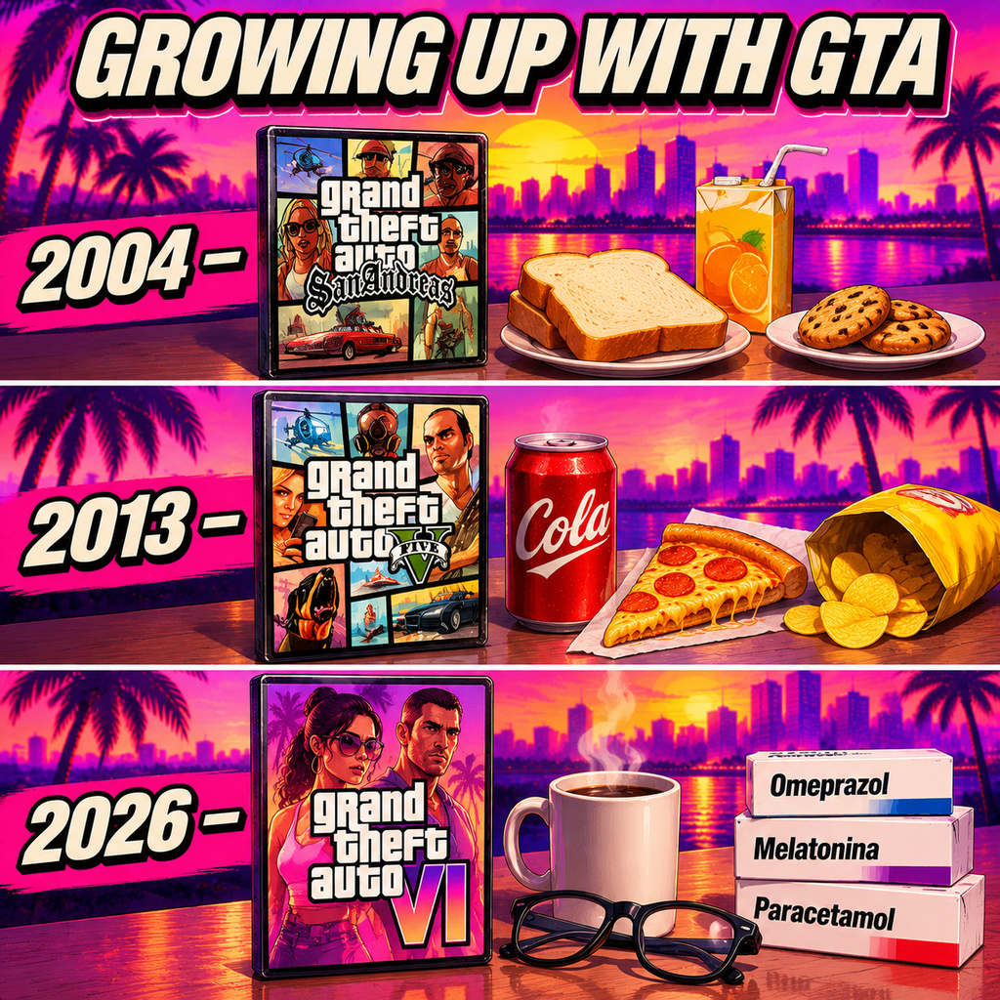

[](https://make.fun/bounty/gta6-meme-x-01)
[](https://make.fun/bounty/gta6-meme-x-01)
[](https://make.fun/bounty/gta6-meme-x-01)

# Growing Up with GTA

A neon Vice City sunset frames three generations of gaming snacks:

- **2004 — San Andreas:** sliced bread, an orange juice carton, and cookies.
- **2013 — GTA V:** a cola can, a pepperoni pizza slice, and a bag of chips.
- **2026 — GTA VI:** Lucia and Jason on the game case, beside coffee, glasses, and medicine boxes labelled **Omeprazol**, **Melatonina**, and **Paracetamol**.

The games keep getting sequels; the player keeps getting older. Childhood snacks become takeaway, then a survival kit for staying awake, seeing the screen, and making it through another launch.



## Entry on X

- **Post:** https://x.com/bangbung169/status/2123579892554236332
- **Account:** public **@bangbung169**, posted 20 November 2026 at approximately **07:51 WIB**.
- **Play code:** `makefun-heather-mountain-thunder`

The caption contains the bounty link, **@makefunai**, and the play code. `POST.json` supplies this published post as the entry. `entry.png` is the accompanying meme, encoded as a **1024×1024 JPEG under 1 MiB** with the required filename.

## Bounty

[**Post a GTA 6 meme on X**](https://make.fun/bounty/gta6-meme-x-01) (`gta6-meme-x-01`)

**Prize pool: $500 · Top 50 paid · Deadline: Monday, 23 November 2026, 21:00 WIB (UTC+7).**

## Run the hand-in

Use **Node.js 22.18 or later**; no dependencies are needed.

```sh
mkdir -p out && MAKEFUN_BOT_DIR=. MAKEFUN_OUTPUT_DIR=out node main.ts
sha256sum POST.json out/POST.json
node --check main.ts
```

`MAKEFUN_BOT_DIR` defaults to `/bot` and `MAKEFUN_OUTPUT_DIR` to `/output`. Relative directory overrides resolve from `main.ts`'s own directory. The runner creates the destination and copies `POST.json` byte-for-byte. Its validation checks the X/Twitter post address and the presence of `entry.png`, then reports the post ID and image size. Errors produce a clear message and a non-zero exit code. All operations use the Node standard library, with no network calls.

[MIT license](LICENSE).

---

Find your next bounty: [make.fun referral](https://make.fun/r/p8atzycs).
